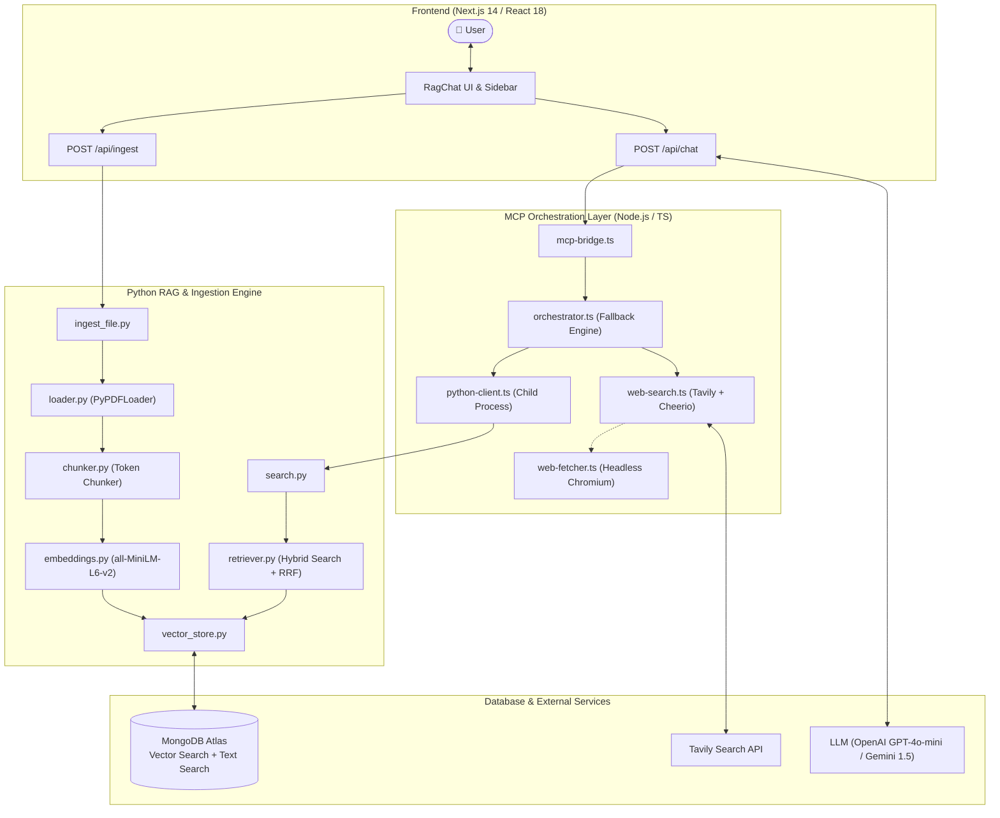
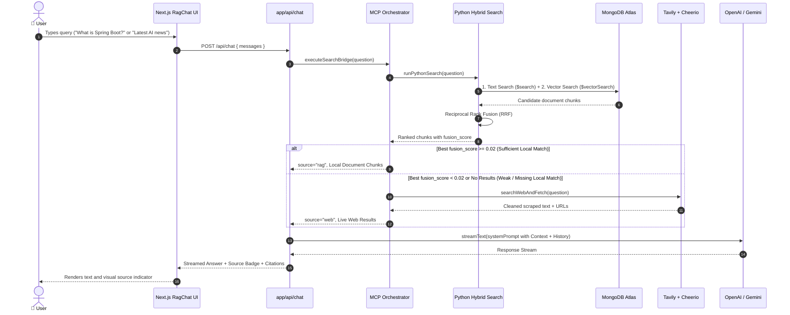

# 🌐 Hybrid RAG with Dynamic Web Fallback & MCP

[](https://nextjs.org/)
[](https://react.dev/)
[](https://www.typescriptlang.org/)
[](https://www.python.org/)
[](https://pytorch.org/)
[](https://www.mongodb.com/products/platform/atlas-database)
[](https://modelcontextprotocol.io/)
[](https://tailwindcss.com/)

An enterprise-grade **Retrieval-Augmented Generation (RAG)** system designed to eliminate knowledge gaps and hallucinations. By uniting **MongoDB Atlas Hybrid Search (Vector + BM25 Text Search)** with an intelligent **Model Context Protocol (MCP) Orchestrator**, the system autonomously evaluates query confidence using **Reciprocal Rank Fusion (RRF)**. When local document knowledge is missing or weak, it dynamically triggers an automated **Web Search Fallback** using Tavily and HTML DOM scraping.

---

## 📑 Table of Contents

- [Key Features](#-key-features)
- [System Architecture](#-system-architecture)
- [Query Execution Flow](#-query-execution-flow)
- [Project Directory Structure](#-project-directory-structure)
- [Tech Stack](#-tech-stack)
- [Prerequisites](#-prerequisites)
- [Environment Configuration](#-environment-configuration)
- [MongoDB Atlas Index Setup](#-mongodb-atlas-index-setup)
- [Installation & Setup](#-installation--setup)
- [Running the Project](#-running-the-project)
- [The Science Behind the Fallback Logic](#-the-science-behind-the-fallback-logic)
- [License](#-license)

---

## 🌟 Key Features

1. **Hybrid Retrieval (Vector + Full-Text Search)**
   - Simultaneously runs **Vector Search** (semantic similarity via cosine distance) and **Full-Text Keyword Search** (`$search` via BM25) on MongoDB Atlas.
   - Merges results using **Reciprocal Rank Fusion (RRF)** to eliminate bias between keyword-heavy queries and abstract conceptual questions.

2. **Self-Evaluating Web Search Fallback**
   - The MCP Orchestrator evaluates the top RRF fusion score against a calibrated threshold (`FALLBACK_THRESHOLD = 0.02`).
   - If local context score is below the threshold or no documents match, the system transparently executes a live web search via **Tavily API** and cleans content using **Cheerio** (with Playwright headless browser support for dynamic JS pages).

3. **Standardized Model Context Protocol (MCP)**
   - Retrieval and web tools are exposed through an official **MCP Server** (`@modelcontextprotocol/sdk`) over standard I/O (`StdioServerTransport`), making the toolchain interoperable with Claude Desktop, Cursor, and agentic workflows.

4. **Custom PyTorch Embedding Engine**
   - Uses HuggingFace `sentence-transformers/all-MiniLM-L6-v2`.
   - Generates normalized 384-dimensional dense vectors with **manual PyTorch mean pooling** and attention mask expansion to eliminate padding tokens, followed by **L2 normalization**.

5. **Token-Aware Sliding Window Chunking**
   - Chunks documents using the exact embedding tokenizer at $500$ tokens per chunk with a $100$-token overlap, preserving vital sentence context and tracking chunk boundaries (`chunk_start`, `chunk_end`, `chunk_id`).

6. **Full-Stack Next.js 14 Dark-Mode UI**
   - Responsive Gemini / ChatGPT-style interface built with Tailwind CSS and Lucide icons.
   - **Real-Time Stream Rendering** with Vercel AI SDK (`ai`).
   - **Source Badging**: Clear visual distinction between `📚 Local RAG Match` and `🌐 Web Fallback Active`.
   - **Collapsible Citations Drawer**: Inspect chunk snippets, page numbers, relevance scores, and external web URLs.
   - **On-Demand Document Ingestion**: Drag-and-drop PDF, TXT, or MD upload with immediate server-side vector embedding.

---

## 🏗 System Architecture



---

## 🔄 Query Execution Flow



---

## 📂 Project Directory Structure

```
rag-with-web-fallback/
├── app/
│   ├── api/
│   │   ├── chat/
│   │   │   └── route.ts              # Streaming LLM endpoint (OpenAI / Gemini / Fallback)
│   │   └── ingest/
│   │       └── route.ts              # Document upload & Python ingestion handler
│   ├── globals.css                   # Tailwind styles and theme customizations
│   ├── layout.tsx                    # Root Next.js layout
│   └── page.tsx                      # Main application view
├── components/
│   ├── DocumentUpload.tsx            # Drag-and-drop file upload with ingestion tracker
│   ├── RagChat.tsx                   # Chat interface with source badges & citation drawers
│   └── Sidebar.tsx                   # Control panel, health indicators & session history
├── lib/
│   └── mcp-bridge.ts                 # Formats raw RAG / Web outputs into LLM context
├── mcp-server/
│   ├── src/
│   │   ├── web/
│   │   │   ├── web-fetcher.ts        # Playwright headless browser fallback
│   │   │   └── web-search.ts         # Tavily search API + Cheerio scraper
│   │   ├── index.ts                  # MCP Server definition (tools: search, web_search)
│   │   ├── orchestrator.ts           # Dynamic fallback decision logic (threshold = 0.02)
│   │   └── python-client.ts          # Subprocess bridge invoking Python retrieval
│   ├── package.json
│   └── tsconfig.json
├── src/
│   ├── data/                         # Sample knowledge base documents (e.g. PDFs)
│   ├── ingestion/
│   │   ├── chunker.py                # Token-based sliding window document chunker
│   │   ├── embeddings.py             # PyTorch mean pooling & L2 normalized embeddings
│   │   ├── ingest_file.py            # CLI entry point for dynamic file ingestion
│   │   └── loader.py                 # PyPDFLoader document parser
│   ├── retrieval/
│   │   ├── retriever.py              # Hybrid search & Reciprocal Rank Fusion (RRF)
│   │   └── search.py                 # CLI wrapper returning JSON results for MCP
│   ├── index_manager.py              # Index creation helper for MongoDB Atlas
│   └── vector_store.py               # MongoDB Atlas Text and Vector Search pipelines
├── main.py                           # Standalone offline ingestion script
├── package.json                      # Next.js & UI dependencies
├── pyproject.toml                    # Python package specifications (uv / pip)
├── .env.example                      # Environment variable template
└── README.md                         # Project documentation
```

---

## 💻 Tech Stack

| Domain | Technology | Purpose |
| :--- | :--- | :--- |
| **Frontend** | [Next.js 14](https://nextjs.org/) (App Router), React 18 | High-performance full-stack web application |
| **Styling & UI** | [Tailwind CSS](https://tailwindcss.com/), Lucide Icons | Responsive Gemini/ChatGPT dark-mode styling |
| **Streaming & AI** | [Vercel AI SDK](https://sdk.vercel.ai/), OpenAI / Google Gemini | Real-time text streaming & prompt orchestration |
| **Protocol** | [Model Context Protocol (MCP)](https://modelcontextprotocol.io/) | Standardized tool registration and communication |
| **Web Search & Scraping** | [Tavily API](https://tavily.com/), Cheerio, Playwright | Live web search and HTML content sanitization |
| **Vector Database** | [MongoDB Atlas](https://www.mongodb.com/atlas) | Unified store for `$search` (BM25) and `$vectorSearch` |
| **Machine Learning** | PyTorch, HuggingFace Transformers | Mean-pooling & 384-dimensional embedding computation |
| **Embedding Model** | `sentence-transformers/all-MiniLM-L6-v2` | Dense semantic representation of text chunks |
| **Python Tooling** | `uv` / Python 3.14+ | Fast Python package management and execution |

---

## ⚙️ Prerequisites

Ensure you have the following installed on your machine:
- **Node.js**: v18.17.0 or higher
- **Python**: v3.11 or higher (v3.14+ compatible, managed via `uv` or `pip`)
- **MongoDB Atlas Account**: An active cluster with Vector Search enabled
- **API Keys**:
  - [Tavily API Key](https://tavily.com/) (for web search fallback)
  - [OpenAI API Key](https://platform.openai.com/) and/or [Google AI Gemini API Key](https://aistudio.google.com/)

---

## 🔑 Environment Configuration

Create a `.env` file in the project root by copying the provided `.env.example`:

```bash
cp .env.example .env
```

Populate the required credentials in `.env`:

```env
# MongoDB Atlas Connection
MONGODB_URI=mongodb+srv://<username>:<password>@<your-cluster>.mongodb.net/?retryWrites=true&w=majority
DATABASE_NAME=rag_database
COLLECTION_NAME=rag_chunks

# Tavily Search API (for Web Fallback)
TAVILY_API_KEY=tvly-your_tavily_key_here

# LLM Providers (Configure at least one)
OPENAI_API_KEY=sk-your_openai_key_here
# or
GEMINI_API_KEY=your_gemini_key_here
GOOGLE_GENERATIVE_AI_API_KEY=your_gemini_key_here
```

---

## 🗄 MongoDB Atlas Index Setup

To enable **Hybrid Search**, two search indices must be created on your MongoDB collection (`rag_chunks`):

### 1. Vector Search Index (`spring_chunks_vector_index`)
Create an Atlas Vector Search index on the collection with the following JSON configuration:

```json
{
  "fields": [
    {
      "type": "vector",
      "path": "embedding",
      "numDimensions": 384,
      "similarity": "cosine"
    }
  ]
}
```

### 2. Full-Text Search Index (`spring_chunks_text_index`)
Create an Atlas Full-Text Search index (or standard text index) mapping the `text` field:

```json
{
  "mappings": {
    "dynamic": false,
    "fields": {
      "text": {
        "type": "string",
        "analyzer": "lucene.standard"
      }
    }
  }
}
```

*(Alternatively, run `python src/index_manager.py` to create the text index programmatically).*

---

## 🚀 Installation & Setup

### 1. Clone the Repository
```bash
git clone https://github.com/your-username/rag-with-web-fallback.git
cd rag-with-web-fallback
```

### 2. Setup Python Virtual Environment & Dependencies

Using `uv` (recommended):
```bash
uv sync
```

Or using standard `pip`:
```bash
python -m venv .venv

# On Windows:
.venv\Scripts\activate
# On macOS/Linux:
source .venv/bin/activate

pip install -r <(python -c "import tomllib; f = open('pyproject.toml', 'rb'); data = tomllib.load(f); print('\n'.join(data['project']['dependencies']))")
# Or directly install dependencies:
pip install langchain langchain-community langchain-huggingface langchain-qdrant pymongo pypdf qdrant-client sentence-transformers torch
```

### 3. Setup Node.js Dependencies
Install root and MCP server dependencies:

```bash
# Install Next.js frontend dependencies
npm install

# Install MCP Server dependencies
cd mcp-server
npm install
cd ..
```

---

## 🏃 Running the Project

### 1. Ingest Initial Document (Optional)
To ingest sample documents into your MongoDB vector store before running the UI:
```bash
# Run the main ingestion script
python main.py
```

### 2. Start the Development Server
Launch the Next.js full-stack application:

```bash
npm run dev
```

Open your browser and navigate to:
```
http://localhost:3000
```

### 3. Testing the MCP Server Directly (Optional)
You can inspect and debug the MCP Server tools using the official MCP Inspector:

```bash
cd mcp-server
npm run inspect
```

---

## 🔬 The Science Behind the Fallback Logic

### 1. Reciprocal Rank Fusion (RRF)
Hybrid search executes lexical search ($T$) and dense vector search ($V$) independently. Combining raw similarity scores directly is flawed because vector cosine similarities and BM25 scores have different mathematical distributions.

RRF solves this by scoring items strictly based on their rank:

$$\text{RRF Score}(d) = \sum_{m \in \{T, V\}} \frac{1}{k + r_m(d)}$$

Where:
- $r_m(d)$ is the 1-indexed rank position of document $d$ in retrieval method $m$.
- $k = 60$ is a smoothing constant that stabilizes rankings and prevents high-rank outliers from distorting results.

### 2. Why Threshold $0.02$?
- **Maximum score (Rank 1 in both searches):**
  $$\frac{1}{60 + 1} + \frac{1}{60 + 1} = \frac{1}{61} + \frac{1}{61} \approx 0.0328$$
- **Solo match (Rank 1 in only one search):**
  $$\frac{1}{60 + 1} = \frac{1}{61} \approx 0.0164$$
- **Cutoff Decision:** Setting `FALLBACK_THRESHOLD = 0.02` guarantees that a document must either:
  - Appear near the top of **both** search methods, or
  - Achieve significant consensus across multiple retrieval angles.

If the top document has a score $< 0.02$, local confidence is deemed insufficient and the query automatically transitions to live web search.

---

## 📜 License

This project is licensed under the [MIT License](LICENSE).
